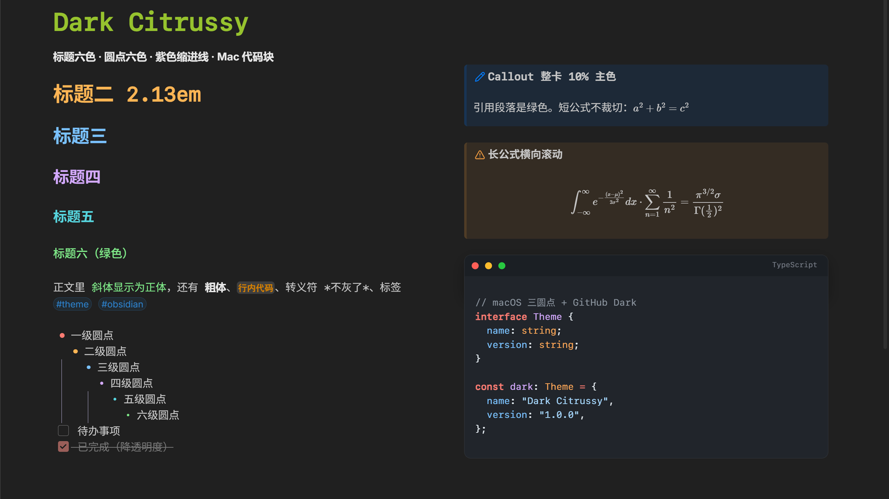

# Dark Citrussy

## English

Dark Citrussy is an Obsidian theme built on [Blue Topaz](https://github.com/PKM-er/Blue-Topaz_Obsidian-css). `theme.css` has two parts: the Blue Topaz stylesheet first, then a personal override layer of about 26 KB.

The override layer started as eight CSS snippets in `.obsidian/snippets/`. Snippets travel with the vault and must be re-enabled on every device and after every theme switch. Merged into a theme, you pick it once.

What changes: italics render upright in the H6 green, escape characters keep the body color, tags become pills, the active line loses its highlight, list bullets use six colors, checkboxes are 16px, completed tasks are dimmed, headings follow a six-color ladder (H1 at 2.13em, −0.21em per level, note title at 2.34em), lists indent 1.65em with purple guide lines, callouts are tinted 10% with the callout color, block formulas scroll horizontally instead of overflowing, and code blocks get a macOS title bar with GitHub Dark syntax colors.

Blue Topaz is MIT licensed, Copyright (c) 2020 WhyI & Pkmer.

Requires Obsidian 1.13 or newer. Dark mode only; the palette is tuned for the dark scheme.



## 覆盖内容

| 区域 | Blue Topaz 默认 | 本主题 |
| --- | --- | --- |
| 斜体 | 斜体字形 | 正体，字色取 H6 绿 |
| 转义符 | 灰色 | 跟随正文色 |
| 标签 | 纯文本 | 胶囊底 |
| 当前行 | 蓝色底纹 | 无底纹 |
| 列表圆点 | 单色 | 六级六色 |
| 勾选框 | 14px | 16px |
| 已完成任务 | 正常 | 降透明度 |
| 标题 | 主题默认阶梯 | H1 2.13em，每级 −0.21em，笔记标题 2.34em，六级六色 |
| 列表缩进 | 主题默认 | 1.65em，紫色引导线 |
| Callout | 按类型分色 | 整卡主色 10% 叠加，quote 用绿色 |
| 公式 | 长公式被裁切 | 块级公式横向滚动，不撑破卡片 |
| 代码块 | 主题默认 | macOS 三圆点标题栏，GitHub Dark 配色 |

## 结构

```
.
├── theme.css       成品，31,948 行
├── manifest.json   主题元数据
├── overrides.css   个人层源文件，改这个再重拼
└── README.md
```

`theme.css` 的分段：

| 段落 | 行 | 内容 |
| --- | --- | --- |
| Blue Topaz | 1–31,190 | 基座原文，不修改 |
| Tweaks | 31,199–31,251 | 斜体、转义符、标签、当前行 |
| List | 31,252–31,336 | 圆点、勾选框、已完成任务 |
| Heading | 31,337–31,456 | 标题阶梯与配色 |
| IndentGuide | 31,457–31,497 | 缩进线 |
| Callout | 31,498–31,565 | 公式与整卡底色 |
| ListGap | 31,566–31,597 | 符号与文字间距 |
| HideFolders | 31,598–31,616 | 隐藏指定文件夹 |
| CodeBlock | 31,617–31,948 | 代码块外观与 token 配色 |

## 常用变量

行号对应 1.0.4。

| 目标 | 行 | 变量或规则 |
| --- | --- | --- |
| 标题字号 | 31,343 | `--lb-h1-size` |
| 标题级差 | 31,344 | `--lb-h-step` |
| 笔记标题字号 | 31,351 | `.inline-title` |
| 六色色板 | 31,261 | `--lb-1` … `--lb-6`、`--lb-ol` |
| 标签胶囊 | 31,221 | `--tag-size` 等 `--tag-*` |
| 当前行底纹 | 31,237 | `--activeline-background` |
| 缩进宽度 | 31,465 | `--list-indent` |
| 引导线颜色 | 31,469 | `rgba(214, 206, 250, …)` |
| 勾选框大小 | 31,273 | `--checkbox-size` |
| Callout 底色浓度 | 31,558 | `color-mix()` 里的 10% |
| 代码块标题栏 | 31,625 | `--mac-cb-*` |
| token 配色 | 31,647 | `--vc-keyword` 等 20 个变量 |

## 工作流

改完 `overrides.css` 后重拼，再覆盖到库里：

```cmd
copy /b "D:\Obsidian\.obsidian\themes\Blue Topaz\theme.css"+"D:\AgentProjects\美化主题_发布Citrussy\overrides.css" "D:\AgentProjects\美化主题_发布Citrussy\theme.css"

copy /b "D:\AgentProjects\美化主题_发布Citrussy\theme.css" "D:\Obsidian\.obsidian\themes\Dark Citrussy\theme.css"
```

Obsidian 里 `Ctrl+P` → `Reload app without saving`。直接改 `theme.css` 末尾也可以，但下次重拼会覆盖掉，`overrides.css` 也会和成品脱节。

## 维护约定

- 1–31,190 行是 Blue Topaz 原文，只改过两处：第 26,744 行 `content: '\A\9\9'';` 改回单引号；第 25,489 行 `background: url(https://cdn.dribbble.com/...gif)` 改成 `background: none;`（主题不允许外链图片）。主题升级时整段替换，其余不在里面改。
- 段落顺序固定。`--tag-size`、`--checkbox-size`、`--list-indent`、`--lg-*` 都挂在 `body` 上，靠后面的段落覆盖前面的，顺序变了结果就变。
- 个人层的 `!important` 用于压过 Blue Topaz 的同名属性，删掉会退回主题默认样式。

## 已知限制

- 代码块 `#21252b`、六色标题、紫色引导线是固定值，系统切浅色时不跟随。主题按暗色调，未声明浅色支持。
- 隐藏文件夹的规则针对 `fonts` 和 `accessary` 两个路径，别人装了只对同名文件夹生效。
- 依赖基座变量 `--activeline-background`、`--list-indent`、`--callout-color`，换基座会失效。

## 安装

已上架社区主题库：[community.obsidian.md/themes/dark-citrussy](https://community.obsidian.md/themes/dark-citrussy)。

在 Obsidian 里打开「设置 → 外观 → 管理主题 → 浏览」，搜 **Dark Citrussy**，安装并选用。离线安装：从 [Releases](https://github.com/Citrussy/my-obsidian-setup/releases/latest) 下载 `theme.css` 和 `manifest.json`，放进 `.obsidian/themes/Dark Citrussy/`。

## 许可

MIT，见 [LICENSE](LICENSE)。

基座 Blue Topaz 同为 MIT，Copyright (c) 2020 WhyI & Pkmer。分发或摘录时保留 `theme.css` 头部的许可声明。
