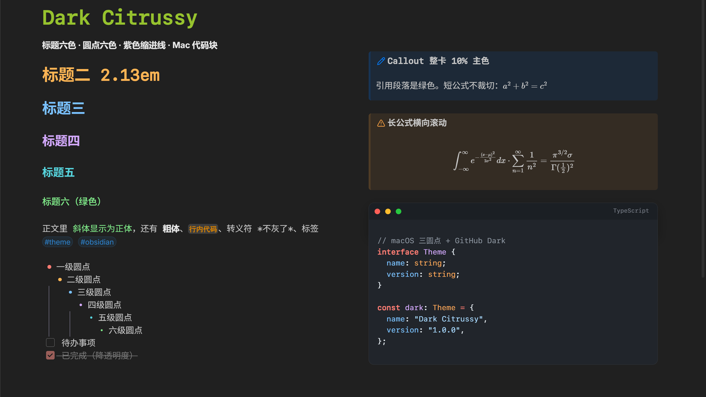

# Dark Citrussy

[English](README.md)

Dark Citrussy 是个 Obsidian 暗色主题，底子是 [Blue Topaz](https://github.com/PKM-er/Blue-Topaz_Obsidian-css)。Blue Topaz 我用了很久，改来改去总是那几处，最后干脆合进一个主题，省掉每台设备重新开八个片段的麻烦。



## 改了什么

- 当前行不加底色。拿到任何主题，我第一件事都是关掉这层蓝色。
- 斜体显示成正体，取 H6 的绿色；转义符保留正文颜色。
- 标签做成小圆角胶囊。
- 无序列表的圆点六色，层级越深越小；有序列表的数字也上色。
- 勾选框 16px，做完的任务变淡。
- 标题六级六色：H1 2.13em，每级减 0.21em，笔记标题 2.34em。
- 列表缩进 1.65em，紫色引导线从上贯到下。
- Callout 整卡铺 10% 主色，引用用主题绿。
- 长公式在卡片里横向滚动，不撑破边框。
- 代码块带 macOS 三圆点标题栏，配色照 GitHub Dark。

## 安装

已上架[社区主题库](https://community.obsidian.md/themes/dark-citrussy)。设置 → 外观 → 管理主题 → 浏览，搜 **Dark Citrussy**，安装后选用。

手动装：从 [Releases](https://github.com/Citrussy/Dark-Cirtussy_Obsidian-css/releases/latest) 下载 `theme.css` 和 `manifest.json`，一起放进 `.obsidian/themes/Dark Citrussy/`。

需要 Obsidian 1.13 及以上。只做了暗色：色板按暗色配的，切到浅色会是半成品。

## 仓库结构

| 文件 | 是什么 |
| --- | --- |
| `theme.css` | 拼好的成品，约 31,900 行。前面是 Blue Topaz，后面是个人层。 |
| `overrides.css` | 个人层源文件。要改就改它。 |
| `manifest.json` | 主题元数据。 |
| `screenshot.png` | 上面那张截图。 |

重拼：把 `overrides.css` 接到 Blue Topaz 的 `theme.css` 后面，再把结果拷进库里。

```cmd
copy /b "path\to\Blue Topaz\theme.css"+"overrides.css" theme.css
```

然后在命令面板里跑 `Reload app without saving`。

## 维护时注意

- `Tweaks` 之前的都是 Blue Topaz 原文，我只动过两处：第 26,744 行打印样式里多出来的引号改回单个，第 25,489 行的外链 Dribbble 动图背景换成 `none`。升级基座时整段替换。
- 顺序不能乱。`--tag-size`、`--checkbox-size`、`--list-indent`、`--lg-*` 这些变量挂在 `body` 上，靠后的段落覆盖前面的，挪一段结果就变。
- `!important` 是用来压 Blue Topaz 同名属性的，删一条基座样式就回来了。
- 有几处写死暗色：代码块底色 `#21252b`、六色标题、紫色引导线。
- 有条规则在文件列表里藏掉 `fonts` 和 `accessary` 两个文件夹。只认这两个名字，换别人的库不生效。
- 个人层依赖 Blue Topaz 的变量（`--activeline-background`、`--list-indent`、`--callout-color`），换基座就失效。

## 许可

MIT，见 [LICENSE](LICENSE)。基座 Blue Topaz 同为 MIT，Copyright (c) 2020 WhyI & Pkmer。分发或摘录时保留 `theme.css` 头部的许可声明。
